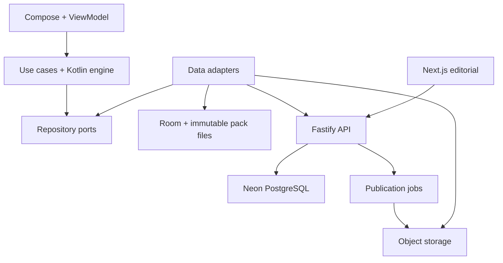
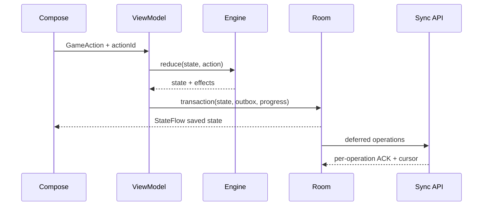

# المعمارية التنفيذية

## حدود الوحدات

Android: Kotlin + Compose Material 3 + Navigation Compose، MVVM/UDF مع StateFlow، Hilt للتركيب، Coroutines للعمل غير المتزامن، Retrofit/OkHttp لشبكة HTTP عبر data adapters. المحرك pure Kotlin بلا Android/Room/HTTP. الواجهة تعتمد على المحرك والمنافذ domain؛ data ينفذ المنافذ؛ app هو composition root. لا اعتماد دائري ولا imports من game engine إلى data أو Compose. سجل renderer منفصل عن سجل قواعد الألعاب، يطابق `type` و`schemaVersion`.

Fastify/TypeScript modular monolith: catalog، packs، identity، sync، competition، editorial. `pg` pooled transport، SQL migrations مرقمة هي المصدر المعتمد للمخطط؛ query parameterization. Next.js لوحة الإدارة عميل للـAPI، وليس لها DATABASE_URL. مهام بناء الحزم في عملية publisher مستقلة من نفس المستودع؛ ليست داخل HTTP request. التخزين S3-compatible + HTTPS Range + CDN، لا ملفات ضخمة في PostgreSQL.



مخطط الأسهم يعبّر عن dependency/call؛ تطبيق الواجهات من data باتجاه ports. UI يقرأ local فقط؛ استجابة HTTP تُكتب محليًا أولًا ثم تُعلن StateFlow. ملفات الحزم بيانات صامتة، لا JavaScript أو DEX أو SQL ينفذ من الخادم.

## شجرة المستودع المقترحة

```text
apps/android/
  app/
  core/{common,designsystem,database,network,preferences,contentpacks,sync,testing}/
  domain/
  data/
  game/{engine,crossword,wordsearch,anagram,imageguess,choice,matching,order,textanswer,sequence}/
  feature/{home,worlds,catalog,session,results,downloads,profile,lexicon,settings,daily}/
  build-logic/
  gradle/libs.versions.toml
apps/admin/
services/api/src/{catalog,packs,identity,sync,competition,editorial}/
services/publisher/
packages/contracts/
content/{drafts,approved,rights}/
infra/migrations/
docs/ADR/
.github/workflows/
```

هذه شجرة هدف؛ الحزمة الحالية لا تحتوي تطبيقًا عاملًا أو scaffolding مزيفًا. بداية المرحلة الثانية تثبت versions متوافقة في lockfiles/version catalog، Java 17 baseline، وminSdk=26؛ targetSdk/compileSdk أحدث إصدار مستقر متوافق يجري التحقق منه وقت البناء. لا استخدام إصدارات alpha. لا غموض في اختيار البنية أو قاعدة البيانات أو transport؛ تحديث أرقام التبعيات قرار صيانة موثق وليس إعادة تخطيط.

## تدفق حل لغز



الحالة المعروضة النهائية بعد commit؛ لتفاعل الحروف يعرض pending input سريعًا لكن indicator الحفظ لا يؤكد قبل commit. session pinned إلى puzzleRevision وpackVersion حتى الانتهاء، ولا يتغير التقييم أثناء الجلسة.

## تشغيل الخدمات لاحقًا

API يدعم حاوية Node طويلة العمر؛ admin قابل للنشر مستقلًا. الاستضافة والميزانية والمنطقة لم تختَر بعد. direct DB URL للترحيلات، pooled للطلبات، transaction-scoped `set_config` لهوية المستخدم. keepalive محدود، pool max=5 لكل instance كقيمة بداية قابلة للقياس؛ timeout 5s للاستعلام العادي. لا عملية provisioning في المرحلة الأولى.

مراجع تقنية: [Android offline-first](https://developer.android.com/topic/architecture/data-layer/offline-first)، [Neon pooling](https://neon.com/docs/connect/connection-pooling). فُحصتا 2026-10-26. التفاصيل هنا قرارات مشروع وليست وعودًا من المزود.
