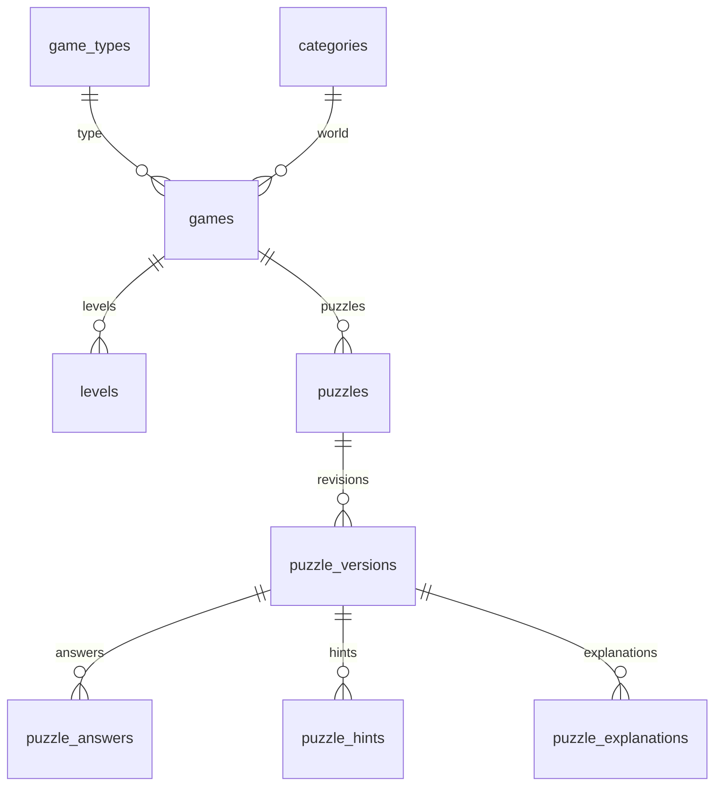
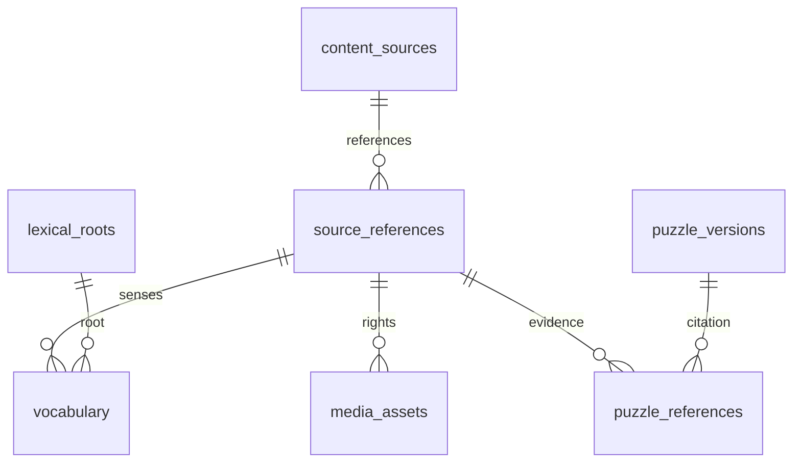
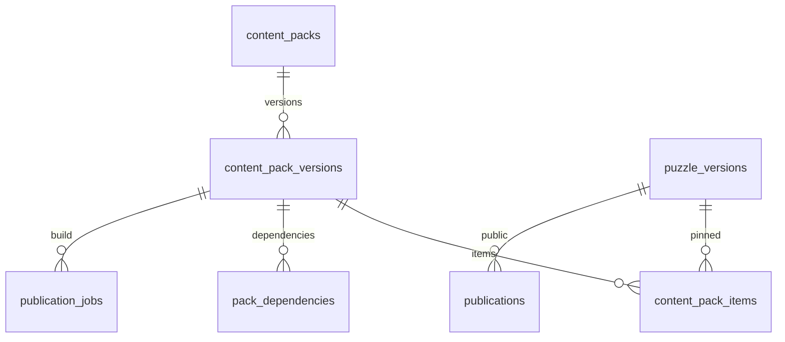
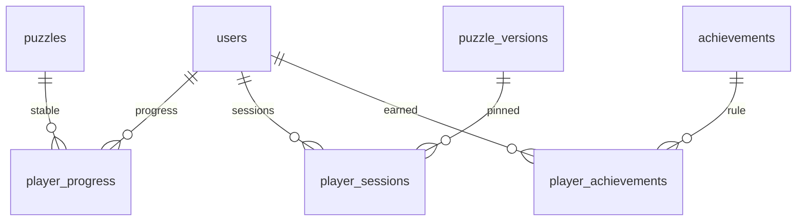
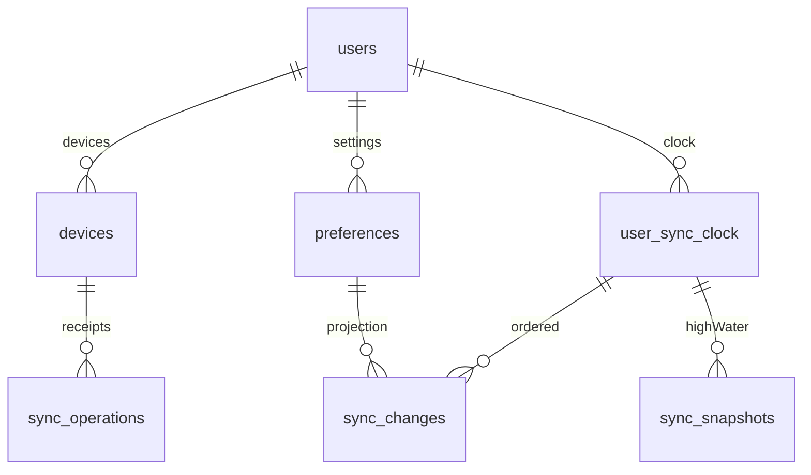
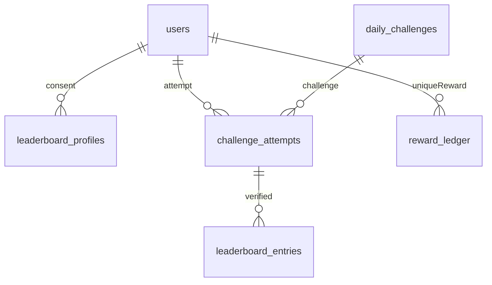
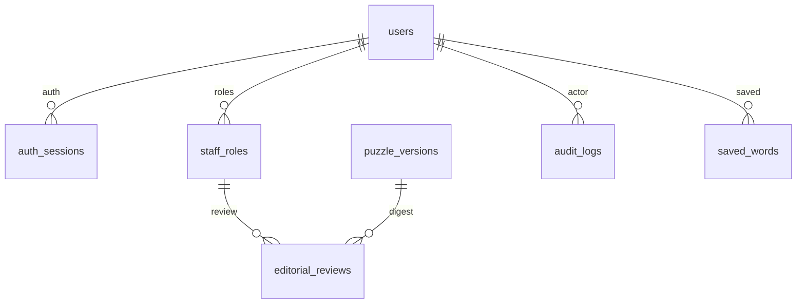

# مخطط PostgreSQL الموحد

المصدر التفصيلي القابل للقراءة الآلية: `database/001_blueprint.sql`. لا يُنفذ آليًا في المرحلة الأولى. UUID يولد في التطبيق/الخادم لا يحتاج extension. البيانات المقترحة مفصولة إلى content وidentity وplay وops وeditorial داخل قاعدة واحدة. أنواع JSON مرتبطة بالعقود، لا تقبل بلا تحقق Fastify + publisher.

## قاموس الجداول

كل SQL التالي جزء فعلي من blueprint، يشمل الأعمدة/PK/FK/CHECK/UNIQUE. كل PK/UNIQUE ينشئ فهرسه؛ الفهارس الإضافية مذكورة. PostgreSQL FK لا يضيف فهرسًا تلقائيًا. الحذف الافتراضي RESTRICT/NO ACTION للمحتوى؛ حذف user يتسلسل للبيانات الخاصة فقط، والمراجعات والتدقيق تُجهل هوية صاحبها SET NULL.

### identity.users

الحساب الاختياري دون تخزين كلمة مرور. الوصول: identity_service؛ own read عبر API.

```sql
  id uuid PRIMARY KEY,
  oidc_issuer text NOT NULL,
  oidc_subject text NOT NULL,
  display_name text,
  created_at timestamptz NOT NULL DEFAULT now(),
  deletion_requested_at timestamptz,
  UNIQUE(oidc_issuer,oidc_subject)
```

الفهارس الإضافية: تكفي PK/UNIQUE للأحجام الأولية

### identity.devices

ربط جهاز عشوائي بحساب. الوصول: own + identity_service.

```sql
  user_id uuid NOT NULL REFERENCES identity.users(id) ON DELETE CASCADE,
  device_id uuid NOT NULL,
  created_at timestamptz NOT NULL DEFAULT now(),
  revoked_at timestamptz,
  PRIMARY KEY(user_id,device_id)
```

الفهارس الإضافية: تكفي PK/UNIQUE للأحجام الأولية

### identity.staff_roles

RBAC التحرير. الوصول: owner فقط للكتابة.

```sql
  user_id uuid NOT NULL REFERENCES identity.users(id) ON DELETE CASCADE,
  role text NOT NULL CHECK(role IN ('owner','editor','linguist','scholar','publisher')),
  PRIMARY KEY(user_id,role)
```

الفهارس الإضافية: تكفي PK/UNIQUE للأحجام الأولية

### content.game_types

تسجيل الأنواع. الوصول: catalog read؛ publisher write.

```sql
  id text PRIMARY KEY,
  engine_version integer NOT NULL CHECK(engine_version>0),
  schema_version integer NOT NULL CHECK(schema_version>0),
  title text NOT NULL
```

الفهارس الإضافية: تكفي PK/UNIQUE للأحجام الأولية

### content.categories

العوالم الستة والفروع؛ فحص الدورات في API. الوصول: catalog read؛ publisher write.

```sql
  id uuid PRIMARY KEY,
  parent_id uuid REFERENCES content.categories(id),
  slug text NOT NULL UNIQUE,
  title text NOT NULL,
  sort_order integer NOT NULL DEFAULT 0
```

الفهارس الإضافية: parent_id

### content.games

النوع مقابل اللعبة التحريرية. الوصول: catalog read enabled؛ publisher write.

```sql
  id uuid PRIMARY KEY,
  game_type_id text NOT NULL REFERENCES content.game_types(id),
  category_id uuid NOT NULL REFERENCES content.categories(id),
  slug text NOT NULL UNIQUE,
  title text NOT NULL,
  enabled boolean NOT NULL DEFAULT false
```

الفهارس الإضافية: game_type_id؛ category_id

### content.levels

التدرج داخل اللعبة. الوصول: catalog read؛ publisher write.

```sql
  id uuid PRIMARY KEY,
  game_id uuid NOT NULL REFERENCES content.games(id),
  ordinal integer NOT NULL CHECK(ordinal>0),
  difficulty smallint NOT NULL CHECK(difficulty BETWEEN 1 AND 5),
  title text NOT NULL,
  UNIQUE(game_id,ordinal)
```

الفهارس الإضافية: تكفي PK/UNIQUE للأحجام الأولية

### content.content_sources

سجل الحقوق العلمي. الوصول: editorial read/write؛ public approved metadata.

```sql
  id uuid PRIMARY KEY,
  slug text NOT NULL UNIQUE,
  name text NOT NULL,
  author text NOT NULL,
  url text,
  edition text,
  license_code text NOT NULL,
  license_evidence_url text,
  permitted_uses jsonb NOT NULL CHECK(jsonb_typeof(permitted_uses)='array'),
  checked_on date,
  approval_status text NOT NULL CHECK(approval_status IN ('candidate','rights_verified','approved','blocked','withdrawn')),
  notes text NOT NULL DEFAULT ''
```

الفهارس الإضافية: تكفي PK/UNIQUE للأحجام الأولية

### content.source_references

صفحة/آية/مدخل مع نسخة. الوصول: editorial write؛ public published references.

```sql
  id uuid PRIMARY KEY,
  source_id uuid NOT NULL REFERENCES content.content_sources(id),
  locator text NOT NULL,
  source_version text NOT NULL,
  excerpt_sha256 char(64) CHECK(excerpt_sha256 ~ '^[a-f0-9]{64}$'),
  attribution text NOT NULL,
  UNIQUE(source_id,locator,source_version)
```

الفهارس الإضافية: source_id

### content.lexical_roots

جذر موثق دون افتراض وحدانية التحليل. الوصول: editorial write؛ public approved projection.

```sql
  id uuid PRIMARY KEY,
  root text NOT NULL,
  reference_id uuid NOT NULL REFERENCES content.source_references(id),
  UNIQUE(root,reference_id)
```

الفهارس الإضافية: reference_id

### content.vocabulary

المعنى المحدد في المرجع لا لفظة غامضة. الوصول: editorial write؛ approved read.

```sql
  id uuid PRIMARY KEY,
  headword text NOT NULL,
  display_text text NOT NULL,
  normalized_key text NOT NULL,
  normalization_version integer NOT NULL CHECK(normalization_version>0),
  root_id uuid REFERENCES content.lexical_roots(id),
  reference_id uuid NOT NULL REFERENCES content.source_references(id),
  sense text NOT NULL,
  review_status text NOT NULL CHECK(review_status IN ('draft','approved','withdrawn'))
```

الفهارس الإضافية: normalized_key؛ root_id؛ reference_id

### content.media_assets

metadata الوسائط؛ الملف خارجي. الوصول: editorial؛ public approved.

```sql
  id uuid PRIMARY KEY,
  source_reference_id uuid NOT NULL REFERENCES content.source_references(id),
  sha256 char(64) NOT NULL CHECK(sha256 ~ '^[a-f0-9]{64}$'),
  object_key text NOT NULL UNIQUE,
  mime_type text NOT NULL CHECK(mime_type IN ('image/webp','image/png','image/jpeg','audio/ogg')),
  bytes bigint NOT NULL CHECK(bytes>0),
  width integer CHECK(width>0 AND width<=4096),
  height integer CHECK(height>0 AND height<=4096),
  alt_text text NOT NULL,
  status text NOT NULL CHECK(status IN ('draft','approved','withdrawn'))
```

الفهارس الإضافية: source_reference_id؛ sha256

### content.puzzles

هوية دائمة مستقلة عن الحزم. الوصول: editorial write؛ published projection.

```sql
  id uuid PRIMARY KEY,
  game_id uuid NOT NULL REFERENCES content.games(id),
  level_id uuid REFERENCES content.levels(id),
  created_by uuid REFERENCES identity.users(id) ON DELETE SET NULL,
  created_at timestamptz NOT NULL DEFAULT now()
```

الفهارس الإضافية: game_id؛ level_id

### content.puzzle_versions

snapshot كامل وحيد مصدر export؛ JSON schema تحقق API/publisher. الوصول: editorial private؛ catalog فقط عبر publications.

```sql
  puzzle_id uuid NOT NULL REFERENCES content.puzzles(id),
  revision integer NOT NULL CHECK(revision>0),
  schema_version integer NOT NULL CHECK(schema_version>0),
  rules_version integer NOT NULL CHECK(rules_version>0),
  difficulty smallint NOT NULL CHECK(difficulty BETWEEN 1 AND 5),
  normalization text NOT NULL CHECK(normalization IN ('exact_v1','arabic_basic_v1')),
  definition jsonb NOT NULL CHECK(jsonb_typeof(definition)='object'),
  definition_sha256 char(64) NOT NULL CHECK(definition_sha256 ~ '^[a-f0-9]{64}$'),
  status text NOT NULL CHECK(status IN ('draft','validation','linguistic_review','scholarly_review','approved','published')),
  author_id uuid REFERENCES identity.users(id) ON DELETE SET NULL,
  created_at timestamptz NOT NULL DEFAULT now(),
  PRIMARY KEY(puzzle_id,revision)
```

الفهارس الإضافية: status, created_at

### content.puzzle_answers

إسقاط answer من definition للمراجعة، لا master ثان. الوصول: publisher projection write؛ editorial read.

```sql
  puzzle_id uuid NOT NULL,
  revision integer NOT NULL,
  slot text NOT NULL,
  accepted jsonb NOT NULL CHECK(jsonb_typeof(accepted)='array'),
  PRIMARY KEY(puzzle_id,revision,slot),
  FOREIGN KEY(puzzle_id,revision) REFERENCES content.puzzle_versions(puzzle_id,revision)
```

الفهارس الإضافية: تكفي PK/UNIQUE للأحجام الأولية

### content.puzzle_hints

إسقاط hints. الوصول: publisher projection write؛ editorial read.

```sql
  puzzle_id uuid NOT NULL,
  revision integer NOT NULL,
  slot text NOT NULL,
  kind text NOT NULL,
  hint_text text NOT NULL,
  penalty integer NOT NULL CHECK(penalty BETWEEN 0 AND 100),
  PRIMARY KEY(puzzle_id,revision,slot),
  FOREIGN KEY(puzzle_id,revision) REFERENCES content.puzzle_versions(puzzle_id,revision)
```

الفهارس الإضافية: تكفي PK/UNIQUE للأحجام الأولية

### content.puzzle_explanations

إسقاط الشرح الموثق. الوصول: publisher projection write؛ editorial read.

```sql
  puzzle_id uuid NOT NULL,
  revision integer NOT NULL,
  slot text NOT NULL,
  body text NOT NULL,
  source_reference_id uuid NOT NULL REFERENCES content.source_references(id),
  PRIMARY KEY(puzzle_id,revision,slot),
  FOREIGN KEY(puzzle_id,revision) REFERENCES content.puzzle_versions(puzzle_id,revision)
```

الفهارس الإضافية: تكفي PK/UNIQUE للأحجام الأولية

### content.puzzle_references

مراجع متعدد لمتعدد. الوصول: editorial/publisher.

```sql
  puzzle_id uuid NOT NULL,
  revision integer NOT NULL,
  reference_id uuid NOT NULL REFERENCES content.source_references(id),
  PRIMARY KEY(puzzle_id,revision,reference_id),
  FOREIGN KEY(puzzle_id,revision) REFERENCES content.puzzle_versions(puzzle_id,revision)
```

الفهارس الإضافية: reference_id

### content.publications

بوابة القراءة؛ السحب دون تعديل snapshot. الوصول: publisher فقط؛ catalog nonwithdrawn.

```sql
  puzzle_id uuid NOT NULL,
  revision integer NOT NULL,
  published_at timestamptz NOT NULL,
  withdrawn_at timestamptz,
  PRIMARY KEY(puzzle_id,revision),
  FOREIGN KEY(puzzle_id,revision) REFERENCES content.puzzle_versions(puzzle_id,revision),
  CHECK(withdrawn_at IS NULL OR withdrawn_at>=published_at)
```

الفهارس الإضافية: تكفي PK/UNIQUE للأحجام الأولية

### content.content_packs

هوية الحزمة. الوصول: catalog read؛ publisher write.

```sql
  id uuid PRIMARY KEY,
  slug text NOT NULL UNIQUE,
  category_id uuid NOT NULL REFERENCES content.categories(id),
  title text NOT NULL,
  is_core boolean NOT NULL DEFAULT false,
  withdrawn_at timestamptz
```

الفهارس الإضافية: category_id

### content.content_pack_versions

manifest immutable بعد النشر؛ الملف الخارجي يحوي توقيعه. الوصول: publisher write؛ catalog published.

```sql
  pack_id uuid NOT NULL REFERENCES content.content_packs(id),
  version integer NOT NULL CHECK(version>0),
  schema_version integer NOT NULL CHECK(schema_version>0),
  min_app_version_code integer NOT NULL CHECK(min_app_version_code>0),
  manifest jsonb NOT NULL,
  manifest_sha256 char(64) NOT NULL CHECK(manifest_sha256 ~ '^[a-f0-9]{64}$'),
  download_bytes bigint NOT NULL CHECK(download_bytes>0),
  installed_bytes bigint NOT NULL CHECK(installed_bytes>0),
  object_key text NOT NULL UNIQUE,
  status text NOT NULL CHECK(status IN ('building','verified','published','withdrawn')),
  published_at timestamptz,
  PRIMARY KEY(pack_id,version)
```

الفهارس الإضافية: status,published_at

### content.content_pack_items

نسخة دقيقة من اللغز داخل الحزمة. الوصول: publisher only write.

```sql
  pack_id uuid NOT NULL,
  pack_version integer NOT NULL,
  puzzle_id uuid NOT NULL,
  puzzle_revision integer NOT NULL,
  PRIMARY KEY(pack_id,pack_version,puzzle_id),
  FOREIGN KEY(pack_id,pack_version) REFERENCES content.content_pack_versions(pack_id,version),
  FOREIGN KEY(puzzle_id,puzzle_revision) REFERENCES content.puzzle_versions(puzzle_id,revision)
```

الفهارس الإضافية: puzzle_id,puzzle_revision

### content.pack_dependencies

DAG التبعيات؛ cycles يتحقق publisher. الوصول: publisher.

```sql
  pack_id uuid NOT NULL,
  version integer NOT NULL,
  dependency_pack_id uuid NOT NULL,
  dependency_version integer NOT NULL,
  PRIMARY KEY(pack_id,version,dependency_pack_id),
  FOREIGN KEY(pack_id,version) REFERENCES content.content_pack_versions(pack_id,version),
  FOREIGN KEY(dependency_pack_id,dependency_version) REFERENCES content.content_pack_versions(pack_id,version),
  CHECK(pack_id<>dependency_pack_id)
```

الفهارس الإضافية: dependency_pack_id,dependency_version

### content.achievements

قواعد الإنجاز بيانات ذات types محددة لا code. الوصول: catalog read؛ publisher write.

```sql
  id uuid PRIMARY KEY,
  code text NOT NULL UNIQUE,
  title text NOT NULL,
  rule_version integer NOT NULL CHECK(rule_version>0),
  rule jsonb NOT NULL
```

الفهارس الإضافية: تكفي PK/UNIQUE للأحجام الأولية

### content.daily_challenges

بنك منافسة خاص لا يدخل الحزم. الوصول: competition private.

```sql
  id uuid PRIMARY KEY,
  challenge_date date NOT NULL UNIQUE,
  starts_at timestamptz NOT NULL,
  ends_at timestamptz NOT NULL,
  rules_version integer NOT NULL CHECK(rules_version>0),
  private_definition jsonb NOT NULL,
  CHECK(ends_at>starts_at)
```

الفهارس الإضافية: تكفي PK/UNIQUE للأحجام الأولية

### play.player_progress

self-reported practice projection. الوصول: own read؛ sync write.

```sql
  user_id uuid NOT NULL REFERENCES identity.users(id) ON DELETE CASCADE,
  puzzle_id uuid NOT NULL REFERENCES content.puzzles(id),
  completed boolean NOT NULL DEFAULT false,
  best_score integer NOT NULL DEFAULT 0 CHECK(best_score BETWEEN 0 AND 300),
  attempts integer NOT NULL DEFAULT 0 CHECK(attempts>=0),
  server_version bigint NOT NULL CHECK(server_version>0 AND server_version<=9007199254740991),
  updated_at timestamptz NOT NULL DEFAULT now(),
  PRIMARY KEY(user_id,puzzle_id)
```

الفهارس الإضافية: puzzle_id

### play.player_sessions

dedup جلسة محلية؛ الحالة التفصيلية تبقى على الجهاز. الوصول: own read؛ sync write.

```sql
  user_id uuid NOT NULL REFERENCES identity.users(id) ON DELETE CASCADE,
  id uuid NOT NULL,
  device_id uuid NOT NULL,
  puzzle_id uuid NOT NULL,
  puzzle_revision integer NOT NULL,
  outcome text NOT NULL CHECK(outcome IN ('won','lost','abandoned')),
  score integer NOT NULL CHECK(score BETWEEN 0 AND 300),
  result_hash char(64) NOT NULL CHECK(result_hash ~ '^[a-f0-9]{64}$'),
  trust text NOT NULL DEFAULT 'self_reported' CHECK(trust='self_reported'),
  received_at timestamptz NOT NULL DEFAULT now(),
  PRIMARY KEY(user_id,id),
  FOREIGN KEY(user_id,device_id) REFERENCES identity.devices(user_id,device_id),
  FOREIGN KEY(puzzle_id,puzzle_revision) REFERENCES content.puzzle_versions(puzzle_id,revision)
```

الفهارس الإضافية: puzzle_id,puzzle_revision؛ user_id,received_at

### play.player_achievements

union فريد. الوصول: own read؛ sync write.

```sql
  user_id uuid NOT NULL REFERENCES identity.users(id) ON DELETE CASCADE,
  achievement_id uuid NOT NULL REFERENCES content.achievements(id),
  awarded_at timestamptz NOT NULL DEFAULT now(),
  server_version bigint NOT NULL CHECK(server_version>0 AND server_version<=9007199254740991),
  PRIMARY KEY(user_id,achievement_id)
```

الفهارس الإضافية: achievement_id

### play.saved_words

حفظ وتراجع/tombstone. الوصول: own + sync.

```sql
  user_id uuid NOT NULL REFERENCES identity.users(id) ON DELETE CASCADE,
  vocabulary_id uuid NOT NULL REFERENCES content.vocabulary(id),
  saved boolean NOT NULL,
  server_version bigint NOT NULL CHECK(server_version>0 AND server_version<=9007199254740991),
  PRIMARY KEY(user_id,vocabulary_id)
```

الفهارس الإضافية: vocabulary_id

### play.preferences

CAS إعدادات. الوصول: own + sync.

```sql
  user_id uuid NOT NULL REFERENCES identity.users(id) ON DELETE CASCADE,
  key text NOT NULL CHECK(key IN ('theme','sound','reducedMotion')),
  value text NOT NULL,
  server_version bigint NOT NULL CHECK(server_version>0 AND server_version<=9007199254740991),
  PRIMARY KEY(user_id,key),
  CHECK((key='theme' AND value IN ('light','dark','system')) OR (key IN ('sound','reducedMotion') AND value IN ('on','off')))
```

الفهارس الإضافية: تكفي PK/UNIQUE للأحجام الأولية

### play.challenge_attempts

attempt واحد رسمي. الوصول: own via competition.

```sql
  user_id uuid NOT NULL REFERENCES identity.users(id) ON DELETE CASCADE,
  id uuid NOT NULL,
  challenge_id uuid NOT NULL REFERENCES content.daily_challenges(id),
  nonce_hash char(64) NOT NULL,
  started_at timestamptz NOT NULL DEFAULT now(),
  expires_at timestamptz NOT NULL,
  submitted_at timestamptz,
  transcript jsonb,
  submission_sha256 char(64) CHECK(submission_sha256 ~ '^[a-f0-9]{64}$'),
  terminal_result jsonb,
  state text NOT NULL DEFAULT 'started' CHECK(state IN ('started','submitted','expired')),
  pinned_definition jsonb NOT NULL,
  pinned_rules_version integer NOT NULL CHECK(pinned_rules_version>0),
  nonce_key_id text NOT NULL,
  verified_score integer CHECK(verified_score>=0),
  PRIMARY KEY(user_id,id),
  UNIQUE(user_id,challenge_id),
  CHECK(expires_at>started_at)
```

الفهارس الإضافية: challenge_id

### play.leaderboard_entries

نقاط خادمية فقط؛ API لا يكشف userId. الوصول: competition write؛ public opt-in projection.

```sql
  challenge_id uuid NOT NULL REFERENCES content.daily_challenges(id),
  user_id uuid NOT NULL REFERENCES identity.users(id) ON DELETE CASCADE,
  attempt_id uuid NOT NULL,
  score integer NOT NULL CHECK(score>=0),
  achieved_at timestamptz NOT NULL,
  opted_in boolean NOT NULL DEFAULT false,
  PRIMARY KEY(challenge_id,user_id),
  FOREIGN KEY(user_id,attempt_id) REFERENCES play.challenge_attempts(user_id,id)
```

الفهارس الإضافية: challenge_id,score DESC,achieved_at,user_id

### play.reward_ledger

منع تكرار مكافأة؛ ليس رصيد عملات في v1. الوصول: sync/competition only.

```sql
  user_id uuid NOT NULL REFERENCES identity.users(id) ON DELETE CASCADE,
  reward_key text NOT NULL,
  awarded_at timestamptz NOT NULL DEFAULT now(),
  details jsonb NOT NULL,
  PRIMARY KEY(user_id,reward_key)
```

الفهارس الإضافية: تكفي PK/UNIQUE للأحجام الأولية

### ops.user_sync_clock

قفل تسلسل commits. الوصول: sync only.

```sql
  user_id uuid PRIMARY KEY REFERENCES identity.users(id) ON DELETE CASCADE,
  version bigint NOT NULL DEFAULT 0 CHECK(version>=0 AND version<=9007199254740991)
```

الفهارس الإضافية: تكفي PK/UNIQUE للأحجام الأولية

### ops.sync_operations

receipt دائم عمر الحساب. الوصول: sync only.

```sql
  user_id uuid NOT NULL REFERENCES identity.users(id) ON DELETE CASCADE,
  operation_id uuid NOT NULL,
  device_id uuid NOT NULL,
  device_seq bigint NOT NULL CHECK(device_seq>0 AND device_seq<=2147483647),
  payload_sha256 char(64) NOT NULL CHECK(payload_sha256 ~ '^[a-f0-9]{64}$'),
  kind text NOT NULL CHECK(kind IN ('complete_session','save_word','set_preference')),
  result jsonb NOT NULL,
  received_at timestamptz NOT NULL DEFAULT now(),
  PRIMARY KEY(user_id,operation_id),
  UNIQUE(user_id,device_id,device_seq),
  FOREIGN KEY(user_id,device_id) REFERENCES identity.devices(user_id,device_id)
```

الفهارس الإضافية: user_id,received_at

### ops.sync_changes

90 يومًا pull log. الوصول: sync only.

```sql
  user_id uuid NOT NULL REFERENCES identity.users(id) ON DELETE CASCADE,
  version bigint NOT NULL CHECK(version>0 AND version<=9007199254740991),
  ordinal integer NOT NULL CHECK(ordinal>=0),
  entity_type text NOT NULL,
  entity_id text NOT NULL,
  value jsonb NOT NULL,
  created_at timestamptz NOT NULL DEFAULT now(),
  PRIMARY KEY(user_id,version,ordinal)
```

الفهارس الإضافية: created_at

### ops.sync_snapshots

snapshot ثابت مع pagination؛ limit payload 20MiB حتى scale redesign. الوصول: sync only.

```sql
  user_id uuid NOT NULL REFERENCES identity.users(id) ON DELETE CASCADE,
  id uuid NOT NULL,
  high_water bigint NOT NULL CHECK(high_water>=0 AND high_water<=9007199254740991),
  payload jsonb NOT NULL,
  expires_at timestamptz NOT NULL,
  PRIMARY KEY(user_id,id)
```

الفهارس الإضافية: expires_at

### editorial.editorial_reviews

review مربوط digest يمنع نشر محتوى تغير بعد المراجعة. الوصول: staff write حسب role؛ publisher read.

```sql
  id uuid PRIMARY KEY,
  puzzle_id uuid NOT NULL,
  revision integer NOT NULL,
  reviewer_id uuid REFERENCES identity.users(id) ON DELETE SET NULL,
  stage text NOT NULL CHECK(stage IN ('validation','linguistic_review','scholarly_review','approved')),
  decision text NOT NULL CHECK(decision IN ('pass','reject')),
  definition_sha256 char(64) NOT NULL,
  notes text NOT NULL,
  created_at timestamptz NOT NULL DEFAULT now(),
  FOREIGN KEY(puzzle_id,revision) REFERENCES content.puzzle_versions(puzzle_id,revision)
```

الفهارس الإضافية: puzzle_id,revision,stage؛ reviewer_id

### editorial.audit_logs

سجل append-only دون أسرار أو نصوص شخصية. الوصول: audit_writer insert؛ owner read.

```sql
  id bigint GENERATED ALWAYS AS IDENTITY PRIMARY KEY,
  actor_id uuid REFERENCES identity.users(id) ON DELETE SET NULL,
  action text NOT NULL,
  entity_type text NOT NULL,
  entity_id text NOT NULL,
  before_sha256 char(64),
  after_sha256 char(64),
  request_id uuid NOT NULL,
  created_at timestamptz NOT NULL DEFAULT now()
```

الفهارس الإضافية: entity_type,entity_id,created_at؛ created_at؛ actor_id

### identity.auth_sessions

جلسات refresh وتدوير العائلة؛ لا token raw. الوصول: identity_service فقط.

```sql
  id uuid PRIMARY KEY,
  user_id uuid NOT NULL REFERENCES identity.users(id) ON DELETE CASCADE,
  family_id uuid NOT NULL,
  refresh_hash char(64) NOT NULL UNIQUE,
  expires_at timestamptz NOT NULL,
  revoked_at timestamptz,
  rotated_to uuid REFERENCES identity.auth_sessions(id)
```

الفهارس الإضافية: user_id؛ family_id؛ expires_at

### editorial.publication_jobs

وظيفة بناء durable مع lease/retry. الوصول: publisher فقط.

```sql
  id uuid PRIMARY KEY,
  pack_id uuid NOT NULL REFERENCES content.content_packs(id),
  version integer NOT NULL CHECK(version>0),
  requested_by uuid REFERENCES identity.users(id) ON DELETE SET NULL,
  state text NOT NULL CHECK(state IN ('queued','running','failed','verified','published')),
  request_payload jsonb NOT NULL,
  error_code text,
  lease_until timestamptz,
  created_at timestamptz NOT NULL DEFAULT now(),
  UNIQUE(pack_id,version)
```

الفهارس الإضافية: state,lease_until

## العقود والقيود عبر الجداول

`puzzle_versions.definition` المصدر الكامل للإجابة والتفسير والتلميحات. الجداول الثلاثة إسقاطات publisher فقط في معاملة واحدة، وممنوع تحريرها من API منفصلة. النشر يعيد حساب digest والإسقاطات ويقارنها؛ definition.type يجب أن يطابق game.game_type_id وgameId والدقة/revision/normalization/difficulty أعمدة الصف. status JSON يطابق عمود status؛ الانتقال إلى published يحفظ artifact نهائيًا ثم يصبح immutable، والمراجعات تقارن digest للحقول المعرفية مع استبعاد status فقط من reviewDigest. `definition_sha256` للمستند الكامل بعد status النهائي؛ `editorial_reviews.definition_sha256` هو reviewDigest المحدد، والاسمان يفسران بهذا التفريق. تعديل غير status يبطل reviewDigest.

مراجع JSON sourceRefs تستخدم source_references.id في production؛ strings الرمزية مسموحة في fixtures فقط. لا نشر حتى resolve لكل reference، وsource.approval_status=approved، والوسائط approved. puzzle.level_id إن وجد يجب أن ينتمي إلى نفس game_id؛ publisher/API يتحققان من ذلك في transaction. cross-field constraints وDAG cycles لا يضمنها CHECK ويختبرها contract validator. content pack لا يضم أي revision غير published وغير withdrawn وقت البناء. الصور في manifest تقابل media_assets.id/hash/bytes في سجل البناء.

## الوصول والترحيلات

RLS enabled+forced على جميع الجداول والافتراضي deny. blueprint لا يضع credentials ولا CREATE ROLE. migration 002 في مرحلة التنفيذ تنشئ NOLOGIN group roles ثم login roles من secret manager وتمنح أقل الصلاحيات. لا يستطيع endpoint استخدام مالك الجداول أو BYPASSRLS.

| runtime role | عمليات مسموحة | سياسة RLS |
|---|---|---|
| api_catalog | SELECT approved catalog projections فقط | published/not withdrawn؛ daily private_definition مستثنى |
| api_identity | users/devices registration/read/revoke | user subject verified ثم SET LOCAL app.user_id؛ registration خدمة محددة |
| api_sync | play practice + ops transaction CRUD محدد | user_id = nullif(current_setting('app.user_id',true),'')::uuid مع USING وWITH CHECK |
| api_competition | challenge_attempts/reward/leaderboard + daily private SELECT | own user للكتابة، bank read للخدمة فقط |
| api_editorial | drafts/reviews + sources | staff role من جدول roles، author≠reviewer، لا published mutation |
| publisher | approvals read؛ snapshots/packs/publications write | workflow service فقط؛ صلاحيات مستقلة عن editor |
| audit_writer | audit INSERT فقط | requestId/actor verified؛ no UPDATE/DELETE |
| migration_owner | DDL، دون استعمال runtime | direct connection في CI المقيد |

catalog views تعمل security_invoker مع policies، أو explicit SELECT column lists؛ لا view بصلاحيات owner تتجاوز الحجب. app.user_id يوضع transaction-local باستعلام parameterized ولا يعبر من headers غير موثوقة. اختبارات تسريب A→B إلزامية. لا منح DML عام لجميع service roles؛ تنفيذ grants/policies مصفوفة أعلاه جزء acceptance المرحلة الثانية، وهي ليست منشورة الآن.

ترحيلات expand→backfill→dual-read→contract؛ لا تعديل migration منشور ولا DROP بيانات لتصحيح التطوير. migration ledger checksum، advisory lock وحيد، direct Neon URL. اختبار empty→latest وprevious→latest على بيئة معزولة بعد تحديد الاستضافة، dump restore قبل تغيير خطر؛ rollback forward-fix غالبًا، وتثبيت API versions يدعم app N وN−1.

## الأداء

catalog cursor=(published_at,pack_id,version) مع immutable snapshot/ETag؛ لا OFFSET كبير. فهرس الجذر/normalized_key للمعجم؛ البحث العربي long-text يحتاج tsvector simple/Gin فقط بعد benchmark، ولا يفترض stemming عربي آلي. progress/user index يبدأ user_id؛ leaderboards ordered keyset. EXPLAIN ANALYZE على 100k puzzles/1M sessions/10k players؛ لا إضافة partitioning قبل القياس. sync_changes cleanup بcreated_at على دفعات؛ audit retention 365 يومًا بسياسة مالك، append-only archive. dedup receipts لا تحذف مع هذا cleanup. Foreign keys الخاصة بالcontent تحفظ tombstone puzzle identities حتى بعد سحب المحتوى، بحيث لا ينكسر progress.

## ERD: فهرس الألعاب



## ERD: المصادر



## ERD: الحزم والنشر



## ERD: تقدم اللاعب



## ERD: المزامنة



## ERD: المنافسة



## ERD: التحرير والهوية



## تصحيحات المراجعة النهائية

SQL النهائي هو المرجع عند اختلاف عرض عمود سابق: trigger المنشور يسمح فقط author_id غير null→null دون أي تغيير آخر، فينجح تجهيل المؤلف مع بقاء المحتوى. challenge_attempts أضيف له submission_sha256/terminal_result/state/pinned_definition/pinned_rules_version/nonce_key_id لحفظ replay evidence بعد حذف transcript. leaderboard_profiles يحفظ consent/alias/moderation مستقلًا عن هوية OIDC؛ ملكية user للقراءة/consent، owner فقط moderation. server versions/high_water مقيدة safe-integer في SQL والعقود.

pack snapshot وitems/dependencies محمية بـtriggers بعد النشر؛ يسمح فقط published→withdrawn دون تغيير bytes/digest/metadata، ولا resurrection. child writes تقفل parent وتمنع mutation متسابقًا مع النشر؛ draft updates بواسطة delete+insert. actor anonymity لا يمس التعريف المنشور. هذه triggers محللة نصيًا ولم تختبر على PostgreSQL بعد، واختبارها بوابة S2-09.

### play.leaderboard_profiles

الوصول: own consent via API؛ moderation owner only. PK يوفر فهرس user_id؛ قراءة الصدارة عبر join.

```sql
 user_id uuid PRIMARY KEY REFERENCES identity.users(id) ON DELETE CASCADE,
 opted_in boolean NOT NULL DEFAULT false,
 alias text CHECK(char_length(alias) BETWEEN 3 AND 24),
 moderation_status text NOT NULL DEFAULT 'none' CHECK(moderation_status IN ('none','pending','approved','rejected')),
 updated_at timestamptz NOT NULL DEFAULT now(),
 CHECK(NOT opted_in OR alias IS NOT NULL)
```
