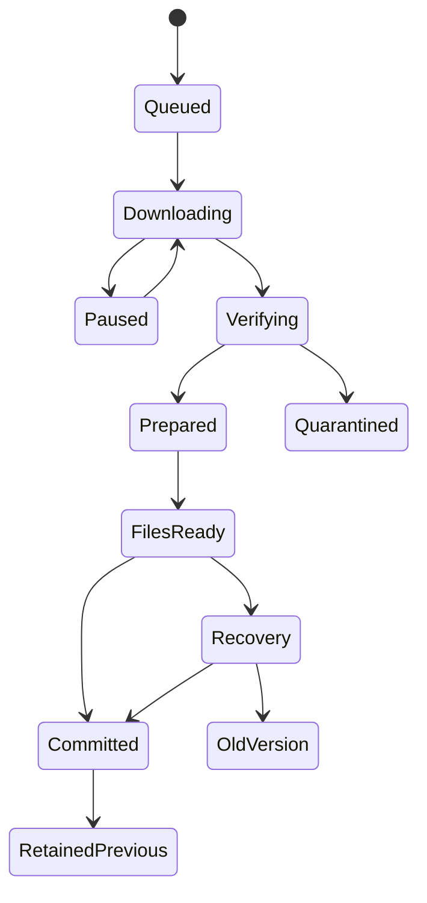

# المحتوى المحلي والتثبيت الذري

Room داخل app-private storage يحوي metadata/fهرس بحث، active version pointer، downloads journal، sessions/progress/outbox. الملفات تحت filesDir/packs/{packId}/{version}/. لا تخزين أساسي في cacheDir الذي قد ينظفه النظام، ولا صلاحية وصول شاملة للملفات. DataStore للإعدادات الصغيرة theme/sound/networkPolicy، وليس معاملات التقدم. object storage للchunks السحابية؛ Neon للmetadata فقط. الأساسي bundled غير قابل للحذف، ويُهيأ محليًا بلا انتظار شبكة؛ يخطط 120 لغزًا معتمدًا وحجم APK 30–50 MiB.

## الجدولة والاستئناف

`DownloadCoordinator` واجهة مشتركة. WorkManager يدير discovery/مزامنة ومتابعة jobs القصيرة والتعافي. التنزيل الكبير الذي يبدأه المستخدم: API34+ User-Initiated Data Transfer Job؛ API26–33 foreground WorkManager مقطع مع notification وتوقف قابل للاستئناف. لا worker ضخم بلا نهاية؛ checkpoint كل chunk وحد زمني، امتثال foreground-service types والقيود الحالية. Android16 يمكن أن يستنفد حصص jobs للworkers الطويلة؛ اختيار UIDT مبني على إرشادات Android الرسمية وليس إسقاط WorkManager.

unique work/lease لكل packId، وmutex بين install/delete؛ لا تثبيتان متوازيان لنفس الحزمة. workers جديدة تقرأ pauseRequested ولا تفترض cancel() حذفا للبيانات. حجم buffer 64KiB، ملفان متوازيان كحد أولي، chunk ≤8MiB. Resume يسجل offset وstrong ETag وhash المتوقع. Range + If-Range: 206 مع Content-Range صحيح يكمل؛ 200 يمسح الجزء ويبدأ هذا chunk؛ 416 يعيد التحقق من حجم/hash قبل اعتبار النجاح. ETag متغير يعيد هذا chunk فقط. signed URL منتهٍ → تجديد الرابط لنفس digest، لا تغيير manifest بصمت.

الشبكة الافتراضية unmetered فقط لكل الحزم الاختيارية؛ لا تنزيل تلقائي كبير عبر الهاتف. طلب صريح يعرض الحجم ويتيح إذنًا لهذا التنزيل وحده. الانتقال إلى metered يوقف عند checkpoint سريع ويحدّث الحالة؛ تغيير Wi-Fi لا يبطل chunks المكتملة. backoff 30s،1m،2m حتى5h مع jitter؛ 429 يحترم Retry-After؛ checksum mismatch مرتين → quarantined وشرح خطأ، لا حلقة تنزيل مستمرة.

## المساحة

قبل الطلب: neededFree = missingChunkBytes + newMaterializedFileBytes + estimatedIndexBytes + safetyMargin. default safetyMargin=max(100MiB,10% من الإضافي). النسخة القديمة موجودة أصلًا ولا يطلب حذفها لتوفير المساحة. يشمل الحساب dependency closure ونسخ إعادة التجميع، مع cache/links optimization لاحقًا فقط إذا اختبر. StatFs بعد كل chunk وقبل rename؛ ENOSPC → pause، حذف partial الآمن حسب اختيار المستخدم، القديمة تبقى. أعداد 64-bit؛ اختبار حزمة منطقية 5GiB لمنع overflow.

## معاملة عبر نظام الملفات وRoom

لا توجد معاملة ذرية مشتركة بين SQLite والملفات؛ نعالجها ببروتوكول recovery:

1. إنشاء journal بحالة DOWNLOADING، pinned manifest digest والنسخة المطلوبة. تحقق التوقيع والتوافق وحقوق النشر قبل تنزيل blobs.
2. تنزيل chunks إلى staging؛ fsync المكتمل ثم hash. تجميع الملفات في staging/version، فحص semantic/schema/المراجع/حدود الوسائط. لا SQL مستورد من الحزمة.
3. استيراد index rows إلى Room بعلامة inactive(version)، transaction batches قابلة للإعادة، ثم validation counts. تجهيز journal=PREPARED، fsync للملفات والدليل.
4. rename داخل نفس filesystem إلى المسار النهائي immutable؛ لا الكتابة فوق نسخة نشطة. journal=FILES_READY. إذا وجد المسار يعاد التحقق من digest أو يعزل؛ لا استبدال صامت.
5. معاملة Room واحدة تتحقق من final files ثم تبدل activeVersion وتزيد catalogGeneration وتحوّل journal=COMMITTED. query الواجهة joins activeVersion فقط. هذا هو commit point.
6. الاحتفاظ بنسخة سابقة واحدة حتى أول open ناجح ومهلة 24 ساعة، مع pin لأي session أو dependency. GC منفصل بعد refcount=0. لا GC خلال transaction.

Crash قبل rename: القديمة نشطة وstaging قابل للمتابعة. بعد rename وقبل commit: final orphan يتحقق ثم يكمل أو ينظف؛ لا UI إليه. بعد commit: startup يتحقق أن الملفات موجودة؛ إن تعذّر القراءة يعود pointer للإصدار السابق ضمن transaction، والنسخة الجديدة quarantined. restore لا يحذف progress/outbox. Journal startup يسبق فتح المحتوى الإضافي ويترك الأساسي جاهزًا.

حذف حزمة: تفريغ active pointer/index بتعامل Room ثم GC الملفات بعد pins=0؛ progress يستخدم puzzleId بلا FK متسلسل إلى pack rows. تعليق جلسة قبل الحذف يتيح التنزيل لاحقًا؛ تعرض واجهة الحذف الجلسات المعلقة. استعادة packs تعيد أحدث manifest المتوافق من catalog؛ إعادة تثبيت التطبيق تفقد guest progress المحلي ما لم يُصدّر أو يربط بحساب، ويجب التصريح بهذا للمستخدم.

## مخطط Room المقترح

| جدول | المفتاح والفهارس | الغرض |
|---|---|---|
| pack_versions | PK(packId,version), active via packs.activeVersion | manifests/path/status/bytes |
| packs | PK(packId), activeVersion nullable, catalogGeneration | pointer واحد |
| puzzle_index | PK(packId,packVersion,puzzleId,revision), index(type,difficulty) | shardPath/offset/length، لا تحميل الكل للذاكرة |
| vocabulary_index + FTS4 | PK(vocabularyId,revision), normalized text | FTS4 متوافق API26؛ normalization مشتق لا المصدر |
| download_jobs/chunks | PK(jobId), UNIQUE(packId), chunk digest/offset | pause/retry/ETag/reservation |
| install_journal | PK(packId,version) | phases/crash recovery |
| sessions | PK(sessionId), index(profileId,status), pinned versions | blob حالة مع stateVersion |
| progress | PK(profileId,puzzleId), bestScore/completed | مستقل عن الحزم |
| achievements | PK(profileId,achievementId) | union محلي |
| outbox | PK(operationId), UNIQUE(deviceId,seq), index(status,nextRetry) | delivery durable |
| sync_cursor | PK(profileId), cursor | pull بعد commit |
| saved_words/preferences | PK(profileId,key), serverVersion | conflict-aware |

المراجع: [Offline first](https://developer.android.com/topic/architecture/data-layer/offline-first)، [قيود workers الطويلة](https://developer.android.com/develop/background-work/background-tasks/persistent/how-to/long-running)، فُحصت 2026-10-26. سياسات التثبيت/الأحجام من تصميم المشروع.
