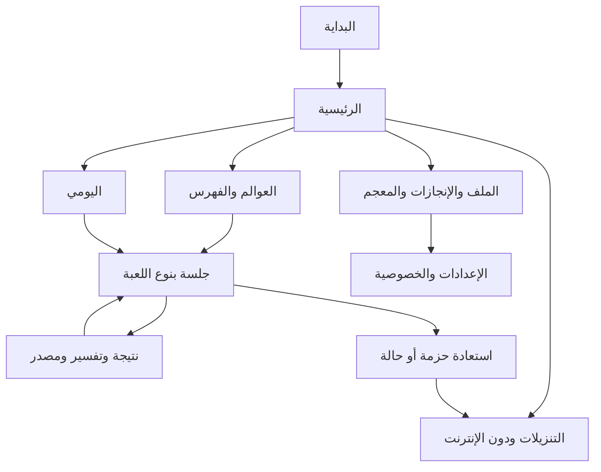

# الهوية وتجربة الاستخدام

## الاتجاه البصري

عالم عربي خيالي هادئ: ورق دافئ وحبر كحلي، زخرفة هندسية خفيفة في الهوامش لا خلف النص، إبراز ذهبي للمكافآت، وألوان مميزة للعوالم مع icon+label لا اللون وحده. لا صور مولدة أو mockups في هذه المرحلة؛ المواصفات التالية للتنفيذ والقياس، وليست إثباتًا لعمل الواجهة.

## Design Tokens

| token | Light | Dark | استخدام |
|---|---|---|---|
| background | #F8F4EC | #101823 | خلفية عامة |
| surface | #FFFFFF | #1B2938 | بطاقات وحوار |
| text.primary | #182536 | #F6F1E7 | النص الأساسي |
| text.secondary | #485666 | #BBC8D3 | الوصف |
| primary | #175E58 | #8DD5C7 | فعل رئيسي |
| onPrimary | #FFFFFF | #083B34 | نص الزر |
| accent | #8A5B14 | #E8BD73 | إنجاز/تحديد |
| error | #A61C32 | #FFB4BE | خطأ مع نص ورمز |
| outline | #667483 | #A3AFBD | حدود الحقول |

الألوان design proposal؛ اختبار contrast آلي لكل حالة عادية/pressed/disabled مطلوب قبل اعتماد نهائي، target4.5:1 للنص العادي و3:1 للكبير/الرسوم المهمة. spacing=4,8,12,16,24,32 dp؛ radius8/16/24؛ touch≥48dp، grid cell48dp عند الإمكان مع zoom/pan للشبكة الكبيرة. انسيابية لا ضغط شبكة15×15 على عرض360dp.

Typography: Noto Sans Arabic لواجهة المستخدم وNoto Naskh Arabic للشواهد **بعد إضافة رخصة ملف الخط الفعلية**؛ fallback system Arabic قبل ذلك. text14/16/20/28sp، lineHeight1.5 للشواهد و1.35 للواجهة؛ لا قص حركات فوق/تحت السطر؛ fontScale حتى200%. الأسطر القرآنية تعرض كاملة غير مقتطعة ellipsis؛ allow wrapping أو scroll سياقي. للمصادر العربية والإنجليزية bidi isolation دون إدخال علامات مخفية في الإجابات المخزنة.

Motion: press90ms، transition180ms، achievement320ms؛ Reduced Motion يحول إلى fade≤100ms ويلغي confetti/parallax، لا وميض. haptic optional؛ sound off/on يحترم silent/accessibility، لا إيقاع زمني إلزامي للحل. لا عداد يومي يصور الغياب فشلًا.

## المكونات المشتركة

`LughzdanTheme`، `WorldCard`، `PuzzleHeader`، `ProgressChip`، `PrimaryAction`، `HintSheet`، `LetterTile`، `CrosswordCell`، `AccessibleGrid`، `PairConnector`، `ReorderCard`، `ImageRevealPanel`، `SourceBadge`، `ExplanationCard`، `DownloadRow`، `StorageMeter`، `ErrorPanel`، `EmptyState`، `SavingIndicator`.

المكونات stateless وتأخذ immutable UiState + callbacks؛ ViewModel وحده يقرأ use cases. semantics تعرض اسم الدور وحالة التحديد/رقم الخلية والصف والعمود؛ لا `contentDescription` يكرر نص زر. اختبارات screenshot RTL/light/dark/fontScale200 مع اختلاف الخط. bottom action zone ضمن وصول الإبهام؛ safe insets/IME، لا زر تحقق خلف لوحة المفاتيح.

## مواصفات 16 شاشة

| الشاشة/route | البيانات والتفاعل | تحميل/فراغ/خطأ | استعادة/وصول |
|---|---|---|---|
| البداية /launch | شعار ثم تهيئة bundled index وprofile | progress محلي لأول تهيئة؛ no network spinner | transactional seed قابل للإعادة؛ error يعيد التهيئة دون حذف progress |
| الرئيسية /home | متابعة آخر جلسة، عوالم، لغز مقترح | لا جلسة→«ابدأ رحلتك»؛ الأساسي يظهر فورًا | restore scroll؛ cards بأسماء واضحة |
| خريطة العوالم /worlds | ستة عوالم، unlock حسب التقدم الاختياري | قسم قيد المراجعة موضح لا نقر ميت | بديل list لقارئ الشاشة؛ لا منع كل اللعب بقفل |
| الفهرس /games?world | نوع/صعوبة/متاح دون اتصال | لا نتائج→امسح الفلاتر؛ pending pack→تنزيل | filters في SavedStateHandle |
| المتقاطعة /session/{id} | grid RTL، clue bar، اتجاه، لوحة حروف | loading محلي قصير؛ missing pack→استعادة | selected cell/direction/input محفوظ؛ pan/zoom/next clue |
| الصور /session/{id} | صورة/أربع صور/ظل، reveal، answer tiles | media integrity→quarantine مع حزمة بديلة | alt أو لغز مكافئ؛ منع stretching |
| الاختيارات /session/{id} | سؤال وخيارات ثم تحقق صريح | لا submit بلا اختيار؛ خطأ بنص | focus stable؛ أي تغيير لا يحتسب محاولة |
| الإجابة /result/{id} | نتيجة، تفسير، المصدر offline، إعادة/التالي | المصدر غير متاح→لا تنشر اللغز أصلًا | لا انتقال تلقائي قبل قراءة التفسير |
| الإنجازات /achievements | المكتسب وأهداف واضحة | صفر→أول لغز، دون وصم | لا تكرار celebration بعد restore |
| المعجم /lexicon | حفظ/بحث عربي/إزالة | لا محفوظات→شرح فائدة؛ فهرسة pending | distinction النص الأصلي/بحث مطبع |
| التنزيلات /downloads | catalog + حجم + Wi-Fi + زر تنزيل | no network يعرض catalog cached وتاريخ | تقدم byte حقيقي؛ pause/resume؛ لا progress وهمي |
| دون الإنترنت /offline | installed versions ومساحة وحذف/استعادة | لا إضافات→الأساسي ثابت؛ ENOSPC action | confirmation يذكر الجلسات والتبعيات؛ progress يبقى |
| الملف /profile | guest، ربط اختياري، export/delete | auth failure لا يقفل اللعب | import preview؛ logout لا يمس guest دون اختيار |
| الإعدادات /settings | خط/مظهر/صوت/haptic/reducedMotion/network/privacy | قيم محلية فورية؛ sync conflict لو ربط | switch semantics؛ restore preferences |
| اليومي /daily | practice cached أو official window UTC مع عرض محلي | offline→practice فقط؛ finished→نتيجة | لا وصف local score رسميًا |
| الأخطاء /error | code مفهوم + retry + offline alternative | لا stacktrace؛ Retry-After عند429 | focus على عنوان الخطأ؛ لا loop تلقائي |

screens للأنواع الأخرى تدار من /session حسب renderer، وليست تحويلًا إلى choice. حالات كل شاشة `Ready|LoadingLocal|Empty|RecoverableError|UnsupportedContent`؛ حالة Offline badge مستقلة لا error blocking. لا skeleton مستمر لمنطقة تعمل محليًا.

## مخطط التنقل

bottom navigation أربعة عناصر: الرئيسية، العوالم، المكتبة، الملف. back أثناء جلسة يحفظ ثم يعود، وإذا saving failure يظهر retry/بقاء لا تجاهل. deep link يتضمن IDs فقط ويحل من Room/catalog؛ لا ينفذ URL أو يفتح state JSON من URI. route arguments ليست محتوى جواب أو token.

## لوحة الإدارة

RTL responsive desktop أولًا مع وضع هاتف صالح للمراجعة: sidebar→drawer، جداول→cards تحت600dp، محرر typed لكل family، review diff ومصدر ملاصق. لا اعتماد نشر بخطوة touch عرضية؛ dialog يعرض revision وdigest والمراجعات. UI لا يملك حق تجاوز validator ولو أخفى زرًا.
